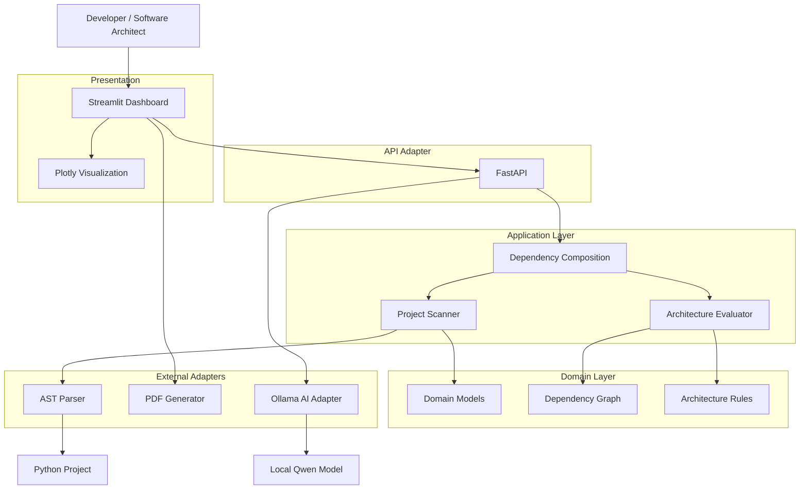

# ArchGuard AI

### AI-Assisted Software Architecture Analysis for Python Projects

**ArchGuard AI** is a software architecture analysis application that examines Python source code, identifies internal dependencies, detects predefined architectural violations, visualizes module relationships, and generates architecture assessment reports.

The system combines **deterministic static analysis** with optional **AI-assisted explanations powered by a locally hosted Qwen language model**.

ArchGuard AI follows principles of **Hexagonal Architecture (Ports and Adapters)**, keeping architectural rules independent of external technologies such as FastAPI, Streamlit, ReportLab, and Ollama.

---

## 1. Project Overview

Maintaining software architecture becomes increasingly difficult as applications grow in size and complexity.

Developers may unintentionally introduce circular dependencies, excessive module coupling, or dependencies that violate intended architectural boundaries.

These issues can make software harder to understand, maintain, test, and extend.

ArchGuard AI addresses this problem by providing an accessible analysis workflow that helps developers inspect their Python projects and identify potential architectural problems.

### Project Goals

- Analyze Python source code without executing the target application.
- Extract modules, imports, classes, methods, and functions.
- Identify internal module dependencies.
- Construct directed dependency graphs.
- Detect circular dependencies.
- Detect high module coupling.
- Identify predefined layer-boundary violations.
- Visualize architectural relationships interactively.
- Generate structured PDF and JSON reports.
- Explain verified architectural findings using a local language model.
- Evaluate detection correctness using reproducible test scenarios.

### Core Principle

**Architectural violations are identified by deterministic rules, not by the language model.**

The AI assistant receives verified findings and generates explanatory recommendations.

AI-generated recommendations are advisory and are not treated as additional verified findings.

---

## 2. Key Features

### 2.1 Python Static Analysis

ArchGuard uses Python's Abstract Syntax Tree (AST) representation to inspect source-code structure.

The analyzer extracts:

- Python modules
- Import statements
- Classes
- Class methods
- Module-level functions
- Inheritance information
- Internal module relationships

The target application's source code is inspected without executing it.

### 2.2 Dependency Graph Analysis

ArchGuard constructs a directed module dependency graph using NetworkX.

Each node represents a Python module, and each directed edge represents a detected internal module dependency.

The graph supports:

- Internal dependency identification
- Circular dependency detection
- Module coupling analysis
- Incoming and outgoing dependency counts
- Interactive visualization

### 2.3 Architectural Rule Detection

ArchGuard currently supports three primary violation categories.

| Rule ID | Description |
|---|---|
| `CIRCULAR_DEPENDENCY` | Identifies cyclic relationships between modules |
| `HIGH_COUPLING` | Identifies modules exceeding the configured coupling criteria |
| `LAYER_BOUNDARY_VIOLATION` | Identifies prohibited dependencies between recognized architecture layers |

The analyzer evaluates these rules using deterministic logic.

Architectural findings contain a rule identifier, severity classification, related module information, and a descriptive message.

### 2.4 Interactive Architecture Visualization

The Streamlit dashboard provides a layer-aware dependency graph built with NetworkX and Plotly.

Features include:

- Color-coded architecture layers
- Interactive node inspection
- Full module names on hover
- Incoming and outgoing dependency counts
- Architecture layer filters
- Directional dependency arrows
- Curved arrows for reciprocal dependencies
- Deterministic node positioning

Reciprocal relationships are displayed using separate curved arrows, making dependency cycles easier to interpret.

### 2.5 Architecture Assessment Reports

ArchGuard supports two report formats.

**JSON reports**

Preserve the structured analysis response, including modules, dependencies, findings, and summary metrics.

**PDF reports**

Provide formatted architecture assessments containing:

- Project identification
- Executive summary
- Architecture metrics
- Dependency relationships
- Architectural findings
- Rule-based recommendations
- Analysis limitations

PDF reports are generated using ReportLab.

### 2.6 Local AI Architecture Assistant

ArchGuard integrates with Ollama to provide optional explanations using a locally hosted language model.

**Default model:** `qwen2.5:7b`

The AI assistant can:

- Explain detected architectural findings
- Describe potential architectural consequences
- Suggest possible refactoring approaches
- Discuss Python-specific dependency concerns
- Identify uncertainties and limitations

The AI adapter uses verified findings supplied by ArchGuard's deterministic analysis engine.

The assistant does not directly modify the analyzed project.

---

## 3. Technology Stack

| Category | Technology |
|---|---|
| Programming language | Python |
| Architecture style | Hexagonal Architecture |
| Static analysis | Python AST |
| Dependency graph | NetworkX |
| Graph visualization | Plotly |
| REST API | FastAPI |
| Web dashboard | Streamlit |
| PDF generation | ReportLab |
| Local AI inference | Ollama |
| Language model | Qwen 2.5 7B |
| HTTP communication | HTTPX and Python urllib |
| Automated testing | pytest |
| Version control | Git |

---

## 4. System Architecture

ArchGuard separates deterministic architectural analysis from its presentation and external integrations.

### High-Level Architecture



This diagram illustrates the principal responsibilities and runtime interactions. It is not an exhaustive Python import graph.

### Architectural Responsibilities

**Domain Layer**

Contains the core models, dependency graph logic, and architectural detection rules.

**Application Layer**

Coordinates project scanning and architectural rule evaluation.

**Adapters Layer**

Provides integrations with AST parsing, HTTP APIs, PDF generation, and local AI inference.

**Dashboard Layer**

Provides the interactive user interface, dependency visualization, analysis results, and report export.

**Bootstrap**

Assembles the components needed to perform architectural analysis.

For detailed architecture documentation, see [Software Architecture and Technical Design](docs/ARCHITECTURE.md).

---

## 5. Project Structure

```text
archguard-ai/
│
├── README.md
├── pyproject.toml
│
├── src/
│   └── archguard/
│       │
│       ├── domain/
│       │   ├── models.py
│       │   ├── dependency_graph.py
│       │   └── architecture_rules.py
│       │
│       ├── application/
│       │   ├── project_scanner.py
│       │   ├── architecture_evaluator.py
│       │   └── ports.py
│       │
│       ├── adapters/
│       │   ├── ast_parser.py
│       │   ├── api.py
│       │   ├── pdf_report.py
│       │   └── ollama_ai.py
│       │
│       ├── dashboard/
│       │   ├── app.py
│       │   ├── visualization.py
│       │   └── graph_edges.py
│       │
│       └── bootstrap.py
│
├── tests/
│   ├── test_api.py
│   ├── test_ai_api.py
│   ├── test_ast_parser.py
│   ├── test_project_scanner.py
│   ├── test_dependency_graph.py
│   ├── test_architecture_rules.py
│   ├── test_layer_boundaries.py
│   ├── test_models.py
│   ├── test_visualization.py
│   ├── test_graph_edges.py
│   ├── test_pdf_report.py
│   ├── test_ollama_ai.py
│   ├── test_dashboard_ai.py
│   ├── test_end_to_end.py
│   └── test_architecture_evaluation.py
│
├── demo_projects/
│   ├── cycle_demo/
│   └── evaluation_cases/
│
├── scripts/
│   └── evaluate_architecture.py
│
├── evaluation_results/
│   └── architecture_evaluation_results.json
│
└── docs/
    └── ARCHITECTURE.md
```

---

## 6. Installation and Setup

### 6.1 Prerequisites

- Python 3.13 or a compatible Python version
- Git
- A Python virtual environment
- Windows PowerShell or a compatible terminal
- Ollama for optional local AI explanations

The project was developed and tested in a Windows environment using Python 3.13.

### 6.2 Clone the Repository

Clone the ArchGuard AI repository using its actual Git remote URL:

```powershell
git clone <REPOSITORY_URL>
cd archguard-ai
```

Replace `<REPOSITORY_URL>` with the repository's Git URL.

For an existing local checkout, open a terminal in the project root instead.

### 6.3 Create a Virtual Environment

On Windows:

```powershell
python -m venv .venv
```

Activate the environment:

```powershell
.\.venv\Scripts\Activate.ps1
```

### 6.4 Install Dependencies

Upgrade pip:

```powershell
python -m pip install --upgrade pip
```

Install the project:

```powershell
python -m pip install -e .
```

Install pytest if it is not already included in the project's development dependencies:

```powershell
python -m pip install pytest
```

All project commands below assume that the virtual environment is activated and the terminal is located at the repository root.

---

## 7. Running ArchGuard AI

The application uses two locally running services:

1. FastAPI — architecture analysis backend.
2. Streamlit — interactive dashboard.

Ollama is optional and required only for AI-generated explanations.

### 7.1 Start the FastAPI Backend

Open a PowerShell terminal in the project root.

Run:

```powershell
python -m uvicorn archguard.adapters.api:app --reload --host 127.0.0.1 --port 8000
```

The API will be available at:

http://127.0.0.1:8000

Interactive API documentation:

http://127.0.0.1:8000/docs

Health endpoint:

http://127.0.0.1:8000/health

Keep this terminal running.

### 7.2 Start the Streamlit Dashboard

Open a second terminal and activate the virtual environment.

Run:

```powershell
python -m streamlit run src/archguard/dashboard/app.py
```

Open the dashboard:

http://localhost:8501

### 7.3 Analyze a Python Project

In the Streamlit sidebar:

1. Enter the project directory.
2. Select **Analyze Project**.
3. Review the analysis summary.
4. Explore the dependency graph.
5. Inspect architectural findings.
6. Export JSON or PDF reports.
7. Optionally request an AI explanation.

Example project directory:

```text
demo_projects/cycle_demo
```

---

## 8. FastAPI Endpoints

ArchGuard exposes the following endpoints.

| Method | Endpoint | Description |
|---|---|---|
| GET | `/` | Basic application information |
| GET | `/health` | Backend health status |
| POST | `/analyze` | Analyze a Python project |
| POST | `/analyze/explain` | Analyze a project and explain verified findings |

### 8.1 Example Analysis Request

Endpoint:

`POST /analyze`

Request body:

```json
{
  "project_path": "demo_projects/cycle_demo"
}
```

### 8.2 Example Response Structure

The response contains:

```json
{
  "project_name": "cycle_demo",
  "summary": {
    "module_count": 2,
    "dependency_count": 2,
    "finding_count": 1
  },
  "modules": [],
  "dependencies": [],
  "findings": []
}
```

The empty arrays above illustrate the response structure only; an actual analysis returns the extracted modules, relationships, and findings.

### 8.3 AI Explanation Endpoint

Endpoint:

`POST /analyze/explain`

Request body:

```json
{
  "project_path": "demo_projects/cycle_demo"
}
```

The endpoint runs deterministic analysis and, when supported findings exist, requests an explanation from the local AI adapter.

If no findings are detected, the adapter reports that there are no rule-specific violations to explain without invoking the model.

---

## 9. Configuring the Local Qwen Model

ArchGuard supports optional local AI explanations through Ollama.

### 9.1 Install Ollama

Install Ollama from its official website:

https://ollama.com

### 9.2 Download the Default Model

Run:

```powershell
ollama pull qwen2.5:7b
```

Verify the model is installed:

```powershell
ollama list
```

### 9.3 Verify Ollama

Run:

```powershell
Invoke-RestMethod http://127.0.0.1:11434/api/tags
```

If the Ollama service is not already running, start it using your Ollama installation.

### 9.4 Configure the Adapter

The default model is:

```text
qwen2.5:7b
```

The default local endpoint is:

```text
http://127.0.0.1:11434
```

Optional environment variables:

```powershell
$env:ARCHGUARD_OLLAMA_MODEL = "qwen2.5:7b"
$env:ARCHGUARD_OLLAMA_URL = "http://127.0.0.1:11434"
```

The current adapter restricts connections to approved local Ollama endpoints.

### 9.5 Generate an Explanation

1. Start FastAPI.
2. Start Streamlit.
3. Ensure Ollama is running.
4. Analyze a project containing architectural findings.
5. Open **AI Architecture Assistant**.
6. Select **Generate AI Explanation**.

The assistant will explain the verified architectural findings and suggest potential improvements.

---

## 10. Demonstration Project

A small demonstration project is included for testing circular dependency detection.

Directory:

```text
demo_projects/cycle_demo/
├── a.py
└── b.py
```

`a.py` contains:

```python
import b
```

`b.py` contains:

```python
import a
```

The two modules import one another, creating a circular dependency in the static module dependency graph.

### Expected Analysis

| Metric | Expected |
|---|---:|
| Python modules | 2 |
| Internal dependencies | 2 |
| Architectural findings | 1 |

Expected finding:

`CIRCULAR_DEPENDENCY`

The graph displays both dependency directions using separate curved arrows.

This project can also be used to demonstrate the Qwen AI assistant.

---

## 11. Automated Testing

ArchGuard AI uses pytest for automated validation.

### Run the Complete Suite

```powershell
python -m pytest -q
```

### Verified Test Results

The latest confirmed full-suite result was:

```text
108 passed, 1 warning in 2.24s
```

The warning was a nonfatal Starlette/httpx test-client deprecation warning.

### Test Coverage Areas

The automated suite includes tests for:

- Domain models
- AST parsing
- Project scanning
- Dependency graph construction
- Circular dependency detection
- High coupling detection
- Layer-boundary rules
- FastAPI endpoints
- AI API integration
- Qwen prompt construction
- AI response handling
- Streamlit AI assistant behavior
- Dependency visualization
- Curved arrow rendering
- PDF report generation
- End-to-end workflows
- Controlled architecture evaluation

Mocked AI tests do not require an active Ollama server.

---

## 12. Architecture Detection Evaluation

ArchGuard was evaluated using five controlled synthetic Python projects.

### 12.1 Evaluation Scenarios

| Scenario | Expected Rule Categories | Result |
|---|---|---|
| Clean architecture | None | PASS |
| Circular dependency | Circular dependency | PASS |
| High coupling | High coupling | PASS |
| Layer-boundary violation | Layer-boundary violation | PASS |
| Multiple violations | All three categories | PASS |

### 12.2 Evaluation Metrics

The evaluation treats each project and rule-category combination as a binary classification example.

Five projects and three rule categories produce fifteen classification opportunities.

| Metric | Value |
|---|---:|
| Evaluated projects | 5 |
| Exact matches | 5 |
| True positives | 6 |
| False positives | 0 |
| False negatives | 0 |
| True negatives | 9 |
| Precision | 1.0000 |
| Recall | 1.0000 |
| F1-score | 1.0000 |
| Exact-match accuracy | 100% |

### 12.3 Interpretation

All five controlled projects produced the expected rule categories.

These results validate the implemented detection rules on the constructed evaluation dataset.

They do not establish perfect performance on arbitrary real-world Python repositories.

Additional testing on independently labeled projects is necessary for broader generalization claims.

### 12.4 Reproduce the Evaluation

Start FastAPI, then run:

```powershell
python scripts/evaluate_architecture.py
```

The script generates an evaluation report at:

```text
evaluation_results/architecture_evaluation_results.json
```

Evaluation regression tests can be run independently:

```powershell
python -m pytest tests/test_architecture_evaluation.py -v
```

---

## 13. Design Principles

### Separation of Concerns

Architectural analysis, presentation, reporting, and AI inference are implemented as distinct responsibilities.

### Dependency Inversion

Hexagonal Architecture principles guide the separation between domain logic and external integrations.

### Deterministic Analysis

Architectural findings come from explicit, testable rules.

### Optional AI Assistance

The application can analyze projects without an available language model.

### Testability

Application components are covered by automated unit, integration, and controlled evaluation tests.

### Reproducibility

Demonstration projects, evaluation fixtures, and evaluation scripts are included in the repository.

---

## 14. Known Limitations

ArchGuard AI currently has several limitations:

- Python is the primary supported language.
- Dynamic imports may not be detected.
- Source inspection does not establish actual runtime behavior.
- Architectural layer detection depends on recognized package conventions.
- Coupling findings depend on configured rule criteria.
- Very large dependency graphs may be difficult to visualize.
- Self-dependency loops are not rendered by the current edge renderer.
- Local AI explanations require an available Ollama model.
- AI-generated recommendations may contain inaccuracies.
- The AI explanation endpoint re-analyzes the selected project, so source changes between requests can result in different analysis snapshots.
- The current detection evaluation uses a small synthetic dataset.

---

## 15. Future Work

Potential improvements include:

- Configurable architectural rules.
- Custom architecture layer definitions.
- Support for additional programming languages.
- More advanced dependency visualization.
- Improved handling of large codebases.
- Additional architecture quality metrics.
- Snapshot-consistent AI explanations.
- Expanded AI model evaluation.
- Architectural change comparison between analyses.
- Evaluation using independently labeled real-world repositories.

---

## 16. Documentation

Additional documentation:

- [Software Architecture and Technical Design](docs/ARCHITECTURE.md)
- [Architecture Evaluation Results](evaluation_results/architecture_evaluation_results.json)

The technical architecture document covers component responsibilities, analysis workflow, design decisions, testing methodology, and known limitations.

---

## 17. Contributors

**Alessandra Vellucci Solari**  
**Sanjana Kaushik**

Graduate student project in Advanced Object-Oriented Design / Software Architecture.

---

## 18. Conclusion

ArchGuard AI demonstrates how deterministic static analysis, modular software design, interactive visualization, structured reporting, and local AI-assisted explanations can be integrated into a Python software architecture analysis application.

The implementation separates verified architectural findings from probabilistic AI explanations.

Its automated test suite and controlled evaluation scenarios provide reproducible evidence for the functionality implemented.

ArchGuard AI serves as a foundation for further research and development in automated software architecture analysis, dependency management, and AI-assisted software engineering.
