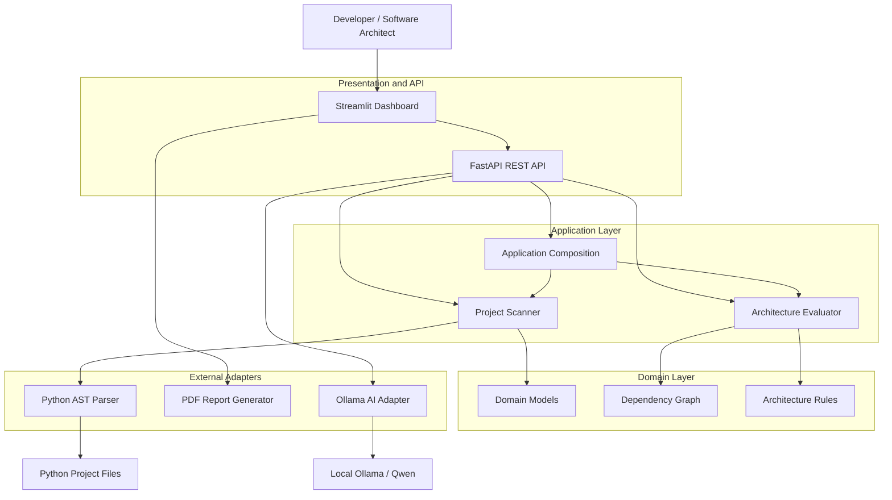
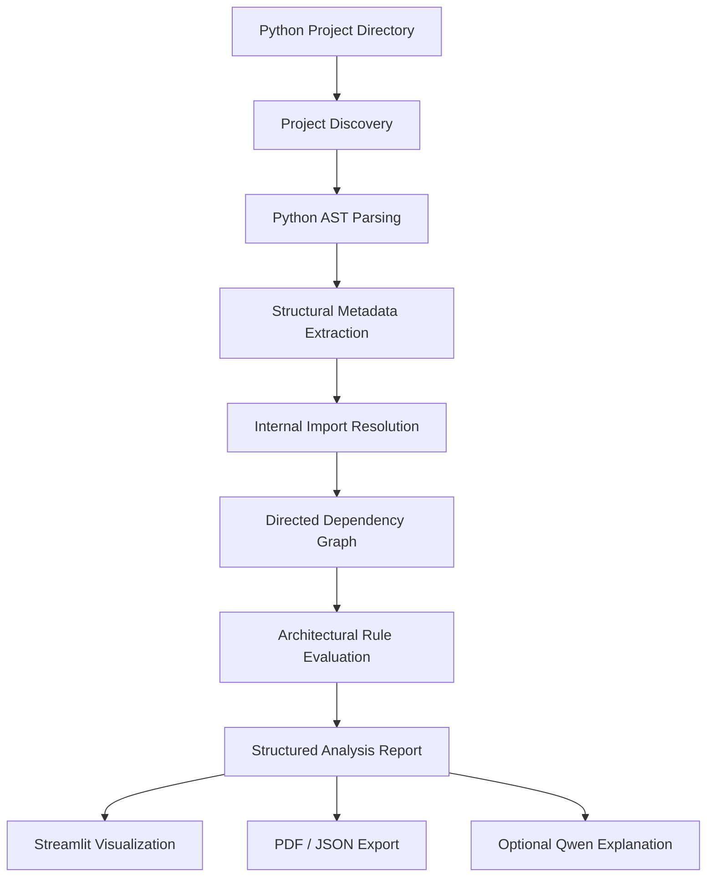
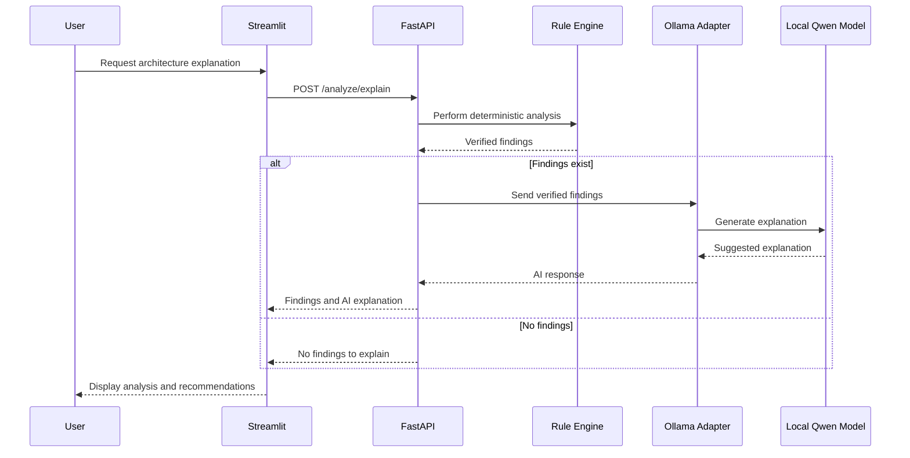

# ArchGuard AI
## Software Architecture and Technical Design

**Project:** ArchGuard AI — Python Software Architecture Analyzer  
**Architecture Style:** Hexagonal Architecture (Ports and Adapters)  
**Implementation Language:** Python  
**User Interface:** Streamlit  
**API Framework:** FastAPI  
**Dependency Analysis:** Python AST and NetworkX  
**Visualization:** Plotly  
**PDF Reporting:** ReportLab  
**AI Integration:** Local Ollama with Qwen 2.5 7B  

---

## 1. Executive Overview

ArchGuard AI is a Python software architecture analysis application designed to inspect source-code structure, extract internal module dependencies, detect predefined architectural violations, and present actionable software design recommendations.

The system combines deterministic static analysis with optional AI-assisted explanations.

Architectural findings are produced by the deterministic rule engine. A locally hosted language model explains those findings and suggests possible refactoring strategies.

The AI assistant is not responsible for discovering architectural violations, and its recommendations are advisory rather than verified corrections.

### 1.1 Project Objectives

The primary objectives are:

1. Analyze Python project source code without executing it.
2. Extract modules, imports, classes, functions, and relationships.
3. Construct a directed internal dependency graph.
4. Identify circular dependencies.
5. Identify modules exceeding the configured coupling threshold.
6. Detect predefined architectural layer-boundary violations.
7. Visualize project dependencies interactively.
8. Generate structured architecture assessment reports.
9. Provide optional AI-assisted architectural explanations.
10. Evaluate detection correctness using reproducible scenarios.

### 1.2 Scope

ArchGuard AI currently focuses on Python projects.

Its analysis relies on source-code inspection and an explicitly defined set of architecture rules.

It is not intended to replace dynamic dependency analysis, runtime profiling, security auditing, or comprehensive software verification.

---

## 2. Architecture Overview

ArchGuard AI follows principles of Hexagonal Architecture, separating business rules, application orchestration, external integrations, and presentation concerns.

The separation allows deterministic analysis logic to remain independent of the Streamlit dashboard, FastAPI request handling, PDF generation, and local LLM inference.

### 2.1 High-Level Component Diagram



The diagram represents the major runtime responsibilities and data flow rather than an exhaustive Python import graph.

### 2.2 Architectural Layers

**Domain Layer**

Contains the core data structures and architectural analysis rules.

Major responsibilities:

- Represent Python modules and classes.
- Model internal dependencies.
- Construct directed dependency graphs.
- Identify cycles and coupling relationships.
- Define architectural violation rules.

**Application Layer**

Coordinates project scanning and architecture evaluation.

Major responsibilities:

- Initiate project scanning.
- Organize parsed module information.
- Coordinate architectural rule evaluation.
- Produce structured analysis data.

**Adapters Layer**

Provides integrations with external technologies.

Examples include:

- Python AST source parsing.
- FastAPI endpoints.
- ReportLab PDF generation.
- Ollama HTTP communication.

**Presentation Layer**

Provides the Streamlit dashboard and graph visualization.

Major responsibilities:

- Accept a project path.
- Display analysis metrics.
- Present dependency graphs.
- Display architectural findings.
- Export analysis reports.
- Request optional AI explanations.

**Bootstrap / Composition**

Connects the application components required to perform an analysis.

---

## 3. Source Code Organization

The principal source modules are organized as follows:

```text
src/
└── archguard/
    ├── domain/
    │   ├── models.py
    │   ├── dependency_graph.py
    │   └── architecture_rules.py
    │
    ├── application/
    │   ├── project_scanner.py
    │   ├── architecture_evaluator.py
    │   └── ports.py
    │
    ├── adapters/
    │   ├── ast_parser.py
    │   ├── api.py
    │   ├── pdf_report.py
    │   └── ollama_ai.py
    │
    ├── dashboard/
    │   ├── app.py
    │   ├── visualization.py
    │   └── graph_edges.py
    │
    └── bootstrap.py
```

This structure separates architectural reasoning from the technologies used to present and distribute results.

### 3.1 Main Components

| Component | Responsibility |
|---|---|
| `models.py` | Represent analyzed Python structures |
| `ast_parser.py` | Extract structural information from Python source |
| `project_scanner.py` | Scan projects and organize parsed modules |
| `dependency_graph.py` | Construct and examine internal dependencies |
| `architecture_rules.py` | Define architectural violation checks |
| `architecture_evaluator.py` | Coordinate evaluation of architecture rules |
| `ports.py` | Define application-facing contracts |
| `bootstrap.py` | Assemble analysis components |
| `api.py` | Expose analysis through HTTP endpoints |
| `visualization.py` | Construct interactive layer-aware graphs |
| `graph_edges.py` | Render directed and curved dependency arrows |
| `pdf_report.py` | Generate formatted PDF assessments |
| `ollama_ai.py` | Generate optional local AI explanations |
| `app.py` | Provide the Streamlit user interface |

---

## 4. Static Analysis Pipeline

ArchGuard analyzes Python source code through a series of deterministic processing stages.

### 4.1 Analysis Pipeline Diagram



### 4.2 Project Discovery

The project scanner traverses the selected project directory and identifies Python source files.

The analysis uses source files as input rather than executing the application.

The scanner also supports directory exclusion behavior, validated through automated tests.

### 4.3 Abstract Syntax Tree Parsing

The AST parser uses Python's syntax tree representation to identify structural information.

The extracted information includes:

- Modules
- Import declarations
- Classes
- Methods
- Functions
- Inheritance information

Using AST parsing avoids relying exclusively on text matching to detect Python syntax.

### 4.4 Internal Dependency Resolution

ArchGuard distinguishes internal project dependencies from external imports.

For example:

```python
import package.module_b
```

If `package.module_b` belongs to the analyzed project, it may be represented as an internal dependency.

Absolute and relative import resolution are covered by automated tests.

### 4.5 Directed Graph Construction

Internal dependencies are represented using a directed graph.

A node represents a Python module.

A directed edge represents a detected dependency from one module to another.

For example:

```text
module_a -> module_b
```

means that `module_a` depends on `module_b` according to the static analysis.

This graph provides the foundation for cycle detection, coupling analysis, and visualization.

---

## 5. Architectural Violation Detection

ArchGuard currently evaluates three major architectural rule categories.

### 5.1 Circular Dependency Detection

Rule identifier:

`CIRCULAR_DEPENDENCY`

A circular dependency exists when a directed dependency path returns to a previously visited module.

Example:

```text
module_a -> module_b
module_b -> module_a
```

Possible architectural consequences include increased coupling and maintenance complexity.

In Python, circular imports may cause initialization-related problems under certain circumstances.

However, detecting an import cycle does not establish that the project has experienced a runtime failure.

### 5.2 High Coupling Detection

Rule identifier:

`HIGH_COUPLING`

This rule identifies modules whose dependency relationships exceed the rule engine's configured coupling criteria.

A highly coupled module may depend on many other internal modules.

Potential consequences include:

- Increased sensitivity to changes.
- More difficult unit testing.
- Reduced modular independence.
- Additional maintenance complexity.

The existence of many dependencies does not automatically establish poor design. The finding should be interpreted in the context of module responsibilities.

### 5.3 Layer-Boundary Violation Detection

Rule identifier:

`LAYER_BOUNDARY_VIOLATION`

This rule checks predefined architectural dependency directions.

For example, a domain module directly importing an infrastructure adapter can violate the intended dependency direction of a Hexagonal Architecture design.

The relevant rule depends on how the project's architecture layers are identified.

This implementation includes a naming-based classification of ArchGuard's own package structure.

Consequently, layer-boundary checks should not be interpreted as universal architectural validation for every possible Python project organization.

---

## 6. FastAPI Integration

FastAPI provides the application's HTTP interface.

### 6.1 Supported Endpoints

| Endpoint | Method | Purpose |
|---|---|---|
| `/` | GET | Basic application information |
| `/health` | GET | Backend health check |
| `/analyze` | POST | Perform deterministic architecture analysis |
| `/analyze/explain` | POST | Analyze and request optional AI explanations |

### 6.2 Analysis Request

Example request:

```json
{
  "project_path": "demo_projects/cycle_demo"
}
```

The API returns a structured analysis containing project information, summary metrics, modules, dependencies, and findings.

The project path is constrained to an allowed workspace configured by the application.

### 6.3 Separation of Responsibilities

The API coordinates requests and responses.

The domain and application components remain responsible for actual architectural analysis.

The Qwen adapter explains verified results rather than replacing the rule engine.

---

## 7. Streamlit Dashboard

The Streamlit dashboard provides an interactive environment for inspecting the analyzed architecture.

The interface includes five primary tabs:

1. Dependency Graph
2. Architectural Findings
3. Module Explorer
4. Export Report
5. AI Architecture Assistant

### 7.1 Dependency Visualization

NetworkX represents the dependency relationships.

Plotly renders the directed graph.

The visualization includes:

- Color-coded architecture layers.
- Deterministic node positions.
- Full module names in hover information.
- Incoming and outgoing dependency counts.
- Layer visibility filters.
- Directional arrows.
- Curved edges for reciprocal dependencies.

The curved edge renderer displays bidirectional relationships separately to improve graph readability.

### 7.2 Architectural Findings

The dashboard displays rule identifiers, severity classifications, and finding descriptions.

The rule engine determines the findings independently of the AI assistant.

### 7.3 Module Explorer

The Module Explorer provides a structured view of the scanned Python modules and their extracted information.

### 7.4 Report Export

The dashboard supports JSON and PDF report export.

The JSON representation preserves the structured analysis output.

The PDF report provides a formatted architecture assessment suitable for review and documentation.

---

## 8. AI-Assisted Architecture Explanations

ArchGuard integrates an optional local language model using Ollama.

### 8.1 Model Configuration

The current default model is:

`qwen2.5:7b`

The Ollama adapter sends inference requests to an approved local endpoint.

### 8.2 AI Explanation Workflow



### 8.3 Prompt Grounding

The prompt instructs the model to:

- Explain only verified findings.
- Preserve module names and rule identifiers.
- Distinguish confirmed observations from possible risks.
- Avoid unsupported runtime or security claims.
- Provide Python-specific suggestions.
- Recognize uncertainty and missing evidence.
- Treat source-derived finding messages as untrusted data.

### 8.4 AI Limitations

Language-model explanations are nondeterministic and may contain inaccuracies.

The implemented prompt improves evidence grounding but does not guarantee factual correctness.

Model output is advisory and should be reviewed before applying architectural changes.

The application does not automatically modify the analyzed source code.

---

## 9. PDF Reporting

The PDF report generator uses ReportLab to create formatted architecture assessment documents.

The report includes:

- Project identification.
- Executive summary.
- Structural analysis metrics.
- Internal dependency relationships.
- Detected architectural findings.
- Deterministic rule-based recommendations.
- Stated analysis limitations.

PDF generation and pagination are covered by automated tests.

---

## 10. Testing Strategy

ArchGuard uses pytest to validate its components.

The test suite covers:

- Domain models.
- AST parsing.
- Project scanning.
- Dependency resolution.
- Circular dependency detection.
- Coupling analysis.
- Layer-boundary rules.
- API behavior.
- AI adapter behavior.
- Streamlit AI interaction logic.
- Dependency visualization.
- Graph edge rendering.
- PDF report generation.
- End-to-end integration.
- Controlled architecture evaluation.

### 10.1 Automated Testing

Tests use temporary project directories and mocked integrations where appropriate.

This provides repeatable execution without requiring a continuously running Ollama service or a Streamlit browser.

The controlled architecture evaluation also exercises the analysis API using FastAPI's in-process test client.

### 10.2 AI Testing

The project uses both mocked adapter tests and a manually observed local Qwen demonstration.

Mocked tests verify request construction, input handling, failure behavior, and response processing.

A successful live explanation was observed for a circular dependency example.

These tests do not constitute a large-scale quantitative evaluation of language-model explanation quality.

---

## 11. Controlled Architecture Evaluation

### 11.1 Evaluation Objective

The goal is to evaluate whether ArchGuard detects expected architectural rule categories across deliberately constructed Python projects.

### 11.2 Dataset Design

Five synthetic scenarios were constructed:

| Scenario | Expected Rule Categories |
|---|---|
| Clean architecture | None |
| Circular dependency | CIRCULAR_DEPENDENCY |
| High coupling | HIGH_COUPLING |
| Layer-boundary violation | LAYER_BOUNDARY_VIOLATION |
| Multiple violations | All three |

The source files are stored under:

`demo_projects/evaluation_cases/`

The evaluation implementation is stored in:

`scripts/evaluate_architecture.py`

The evaluation output is stored in:

`evaluation_results/architecture_evaluation_results.json`

### 11.3 Evaluation Methodology

Each evaluation project is analyzed using ArchGuard.

Detected rule categories are compared against the manually specified expected categories.

Each project and rule-category pair is considered one binary classification opportunity.

Five projects evaluated against three rule categories produce fifteen classification opportunities.

### 11.4 Observed Results

All five controlled projects matched their expected rule categories.

| Metric | Observed Value |
|---|---:|
| Evaluated projects | 5 |
| Exact project matches | 5 |
| True positives | 6 |
| False positives | 0 |
| False negatives | 0 |
| True negatives | 9 |
| Precision | 1.0000 |
| Recall | 1.0000 |
| F1-score | 1.0000 |
| Exact-match accuracy | 1.0000 |

The results validate correct rule-category detection on the five constructed examples.

### 11.5 Interpretation

The controlled evaluation demonstrates that the implemented detector recognizes the predefined patterns used in the synthetic dataset.

It does not establish perfect accuracy on arbitrary real-world Python projects.

Additional evaluation is needed on independently labeled repositories, diverse import structures, and more complex architectural organizations.

---

## 12. Design Decisions and Tradeoffs

### 12.1 Hexagonal Architecture

**Decision:** Separate domain rules from application interfaces and external integrations.

**Benefit:** Improves modularity, testability, and separation of responsibilities.

**Tradeoff:** Introduces additional abstractions and module organization.

### 12.2 AST-Based Parsing

**Decision:** Inspect Python syntax rather than executing analyzed projects.

**Benefit:** Enables repeatable source-level analysis without requiring execution of the target program.

**Tradeoff:** Does not fully resolve dynamic imports or runtime-dependent behavior.

### 12.3 NetworkX Dependency Graph

**Decision:** Represent module relationships as a directed graph.

**Benefit:** Supports cycle detection, dependency measurement, and visualization.

**Tradeoff:** Graph quality depends on the completeness of static dependency extraction.

### 12.4 Deterministic Rules Before AI

**Decision:** Use explicit architecture rules to identify findings, then optionally ask Qwen to explain them.

**Benefit:** Keeps finding detection separate from probabilistic language generation.

**Tradeoff:** Detection coverage is limited to implemented architectural rules.

### 12.5 Local AI Inference

**Decision:** Use Ollama with a locally hosted Qwen model.

**Benefit:** Avoids sending finding data to a hosted inference API in the implemented local workflow.

**Tradeoff:** Local inference requires model installation and sufficient computing resources.

---

## 13. Known Limitations

Current limitations include:

1. Analysis focuses on Python source code.
2. Dynamic imports and runtime-generated dependencies may be missed.
3. Architectural layer detection depends on configured or recognized package conventions.
4. Coupling findings depend on the rule engine's chosen threshold and definition.
5. The source parser may encounter unsupported or invalid source encodings.
6. Self-dependency loops are not drawn by the current curved-edge renderer.
7. Large dependency graphs may become visually crowded.
8. AI recommendations may be incomplete or inaccurate.
9. AI inference is dependent on availability of the local Ollama service.
10. Evaluation results currently reflect a small synthetic dataset rather than independently labeled real-world repositories.
11. The AI explanation endpoint performs a fresh analysis, so source changes between dashboard analysis and explanation requests can produce inconsistent snapshots.

---

## 14. Future Improvements

Potential future enhancements include:

- Support for additional programming languages.
- More configurable architecture rules.
- User-defined architecture layer mappings.
- Advanced dependency graph layouts.
- Improved visualization scalability.
- Snapshot identifiers to keep analysis and AI explanations synchronized.
- More robust Python source encoding handling.
- Automated comparison of architecture reports.
- Larger evaluation datasets with independently reviewed labels.
- Expanded evaluation of AI explanation accuracy.
- Additional architectural metrics and quality indicators.

---

## 15. Reproducibility

### 15.1 Run the Automated Tests

From the project root with the virtual environment activated:

```powershell
python -m pytest -q
```

### 15.2 Start FastAPI

```powershell
python -m uvicorn archguard.adapters.api:app --reload --host 127.0.0.1 --port 8000
```

### 15.3 Start Streamlit

In another terminal:

```powershell
python -m streamlit run src/archguard/dashboard/app.py
```

Open:

`http://localhost:8501`

### 15.4 Run the Controlled Evaluation

With FastAPI running:

```powershell
python scripts/evaluate_architecture.py
```

The evaluation generates:

`evaluation_results/architecture_evaluation_results.json`

### 15.5 Demonstrate Circular Dependency Detection

Analyze:

`demo_projects/cycle_demo`

Expected characteristics:

- Two Python modules.
- Two directed internal dependencies.
- One circular-dependency finding.

Use the Dependency Graph tab to view both directional edges.

The AI Architecture Assistant can be used to request an explanation if Ollama and the configured Qwen model are available.

---

## 16. Conclusion

ArchGuard AI demonstrates the integration of deterministic static architecture analysis, modular software design, interactive visualization, structured reporting, and optional local AI assistance.

The system identifies predefined architecture violations and presents those findings through an accessible dashboard and downloadable reports.

The five-scenario controlled evaluation produced exact matches for all expected rule categories, while the local Qwen integration demonstrated the feasibility of generating explanations grounded in deterministic findings.

The results support the system's correctness on the evaluated patterns, while also highlighting the need for broader evaluation before making claims about general-purpose architectural detection accuracy.

ArchGuard AI provides a foundation for extending automated architecture analysis with additional rules, richer visualizations, and more comprehensive software quality assessments.
