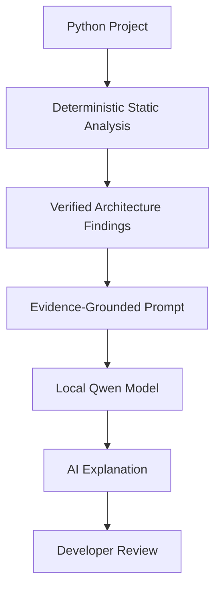

# ArchGuard AI
## Architectural Design Decisions and Software Engineering Principles

**Project:** ArchGuard AI — AI-Assisted Software Architecture Analysis  
**Architecture:** Hexagonal Architecture (Ports and Adapters)  
**Language:** Python  
**Primary interfaces:** FastAPI and Streamlit  
**AI integration:** Ollama with Qwen 2.5 7B  
**Document type:** Software Architecture Design Rationale

---

## 1. Introduction

ArchGuard AI is a Python software architecture analyzer designed to examine source-code structure, identify internal dependencies, detect predefined architectural violations, and generate actionable architectural assessments.

The project combines deterministic static analysis with optional AI-assisted explanations.

This document explains the architectural choices behind ArchGuard AI, the object-oriented design principles guiding its implementation, the tradeoffs of the selected technologies, and areas for future improvement.

The goal is to justify the software design in terms of maintainability, modularity, testability, extensibility, and separation of responsibilities.

---

## 2. Architectural Goals

The architecture was designed around the following quality goals.

| Quality Attribute | Design Goal |
|---|---|
| Modularity | Separate analysis logic from presentation and external services |
| Maintainability | Keep components focused and changes localized |
| Testability | Test architecture rules independently of external applications |
| Extensibility | Support additional architectural rules and adapters |
| Reliability | Handle invalid projects and unavailable external services |
| Reproducibility | Produce repeatable static analysis results |
| Privacy | Support local AI inference without a hosted LLM API |
| Explainability | Separate verified architectural findings from generated explanations |

These quality goals informed the system's package organization and the division of responsibilities between its components.

---

## 3. Architectural Decision 1: Hexagonal Architecture

### 3.1 Decision

ArchGuard AI follows the principles of Hexagonal Architecture, also known as Ports and Adapters.

The implementation separates its domain logic, application orchestration, external adapters, and presentation interface.

Core architectural analysis is not implemented inside Streamlit or FastAPI route handlers.

### 3.2 Rationale

The purpose of this separation is to prevent external technology decisions from controlling the fundamental architecture rules.

For example, changing the user interface should not require rewriting circular dependency detection.

Similarly, adopting a different PDF library should not require modifying the dependency graph implementation.

### 3.3 Project Components

**Domain**

- `domain/models.py`
- `domain/dependency_graph.py`
- `domain/architecture_rules.py`

These modules represent the analysis domain, dependency relationships, and architectural rule logic.

**Application**

- `application/project_scanner.py`
- `application/architecture_evaluator.py`
- `application/ports.py`

These modules coordinate source scanning and architectural evaluation and provide application-facing contracts.

**Adapters**

- `adapters/ast_parser.py`
- `adapters/api.py`
- `adapters/pdf_report.py`
- `adapters/ollama_ai.py`

Adapters provide source parsing, HTTP communication, PDF generation, and AI inference.

**Presentation**

- `dashboard/app.py`
- `dashboard/visualization.py`
- `dashboard/graph_edges.py`

The presentation modules provide user interaction and architectural graph visualization.

**Composition**

- `bootstrap.py`

The bootstrap module assembles analysis components.

### 3.4 Benefits

- Core analysis logic is separated from UI implementation.
- Infrastructure changes can be localized to adapters.
- Components can be tested independently.
- New external integrations can be added without redesigning the entire application.
- Architectural responsibilities are easier to explain and review.

### 3.5 Tradeoffs

Hexagonal Architecture introduces more modules and abstractions than a single-file application.

For a small project, this increases initial development effort.

However, ArchGuard AI contains multiple responsibilities—parsing, graph analysis, rule evaluation, reporting, visualization, and AI inference—making architectural separation beneficial.

### 3.6 Important Qualification

ArchGuard uses a layered package structure influenced by Hexagonal Architecture.

A fully strict implementation would require verifying that all source-code imports and dependency directions conform to the intended ports-and-adapters boundaries.

Therefore, the architecture should be described as following Hexagonal Architecture principles rather than assuming that every dependency is formally validated.

---

## 4. Architectural Decision 2: Deterministic Static Analysis

### 4.1 Decision

Architectural violations are identified through deterministic rules operating on a graph derived from Python source-code analysis.

The language model does not create authoritative architectural findings.

### 4.2 Rationale

Language models may produce plausible explanations without sufficient evidence.

Using a deterministic rule engine establishes a clearer boundary between observed source-code relationships and generated recommendations.

For a given source snapshot and consistent analyzer configuration, the rule engine is intended to produce repeatable findings.

### 4.3 Supported Rule Categories

| Rule | Description |
|---|---|
| `CIRCULAR_DEPENDENCY` | Identifies cyclic module relationships |
| `HIGH_COUPLING` | Identifies modules exceeding configured coupling criteria |
| `LAYER_BOUNDARY_VIOLATION` | Identifies predefined prohibited architectural dependencies |

### 4.4 Benefits

- Findings are traceable to explicit rules.
- Rule behavior can be verified using automated tests.
- The analyzer does not depend on LLM availability.
- Results can be evaluated against known examples.
- AI-generated text cannot silently add verified violations.

### 4.5 Tradeoffs

Explicit rules detect only the patterns they implement.

They do not provide complete architectural judgment or understand every design intention.

For example, high coupling may be appropriate for some coordination modules, and an import cycle does not necessarily cause a runtime failure.

The system therefore reports architectural findings for developer review rather than automatically declaring the analyzed application defective.

---

## 5. Architectural Decision 3: Python AST Parsing

### 5.1 Decision

ArchGuard uses Python's Abstract Syntax Tree functionality for source-code inspection.

### 5.2 Rationale

AST parsing provides structured access to Python syntax, including imports, classes, methods, and functions.

This is more suitable than relying exclusively on regular expressions for structural analysis.

### 5.3 Benefits

- Source code does not need to be executed.
- Python syntax can be inspected structurally.
- The implementation supports absolute and relative import extraction.
- Class and function information can be represented consistently.
- The parser can be tested using controlled source files.

### 5.4 Limitations

Static parsing cannot necessarily identify:

- Dynamic imports resolved at runtime.
- Dependencies constructed from strings.
- Runtime plugin loading.
- Dependencies introduced through reflection.
- Runtime import conditions that cannot be resolved statically.

AST parsing also requires source files to be readable and syntactically valid under the selected Python parser.

### 5.5 Alternatives Considered

**Regular expressions**

Simpler to implement for narrow patterns, but less reliable for complex Python syntax.

**Runtime instrumentation**

Can observe executed imports, but requires running the target project and depends on which execution paths are exercised.

**AST parsing**

Selected because it supports repeatable structural analysis without executing the target application.

---

## 6. Architectural Decision 4: Directed Dependency Graph

### 6.1 Decision

ArchGuard represents internal module dependencies using NetworkX's directed graph model.

### 6.2 Rationale

Module dependencies are naturally represented as directed relationships.

If module A imports module B, the graph contains a dependency from A to B.

For example:

```text
A --> B
B --> C
```

A circular dependency may be represented as:

```text
A --> B
B --> A
```

### 6.3 Benefits

The graph representation supports:

- Circular dependency analysis.
- Incoming and outgoing dependency counts.
- Coupling measurements.
- Relationship visualization.
- Consistent graph-based evaluation.

### 6.4 Why NetworkX?

NetworkX provides an established graph representation and algorithms suitable for Python-based graph analysis.

Using an existing library reduces the need to implement and maintain low-level graph data structures.

### 6.5 Tradeoffs

NetworkX is well suited to the current project scope, but its in-memory graph representation may require performance evaluation for very large repositories.

Large dependency graphs may also require aggregation or filtering to remain understandable.

---

## 7. SOLID Principles

ArchGuard AI's design is informed by the five SOLID principles.

The mappings below describe architectural intent and representative implementation responsibilities. Full SOLID compliance would require additional code-level review and dependency auditing.

### 7.1 Single Responsibility Principle (SRP)

**Principle:** A component should have one primary reason to change.

ArchGuard divides responsibilities among dedicated modules.

| Component | Primary Responsibility |
|---|---|
| AST Parser | Extract Python source structure |
| Project Scanner | Discover and organize project modules |
| Dependency Graph | Represent module relationships |
| Architecture Rules | Identify architectural violations |
| Architecture Evaluator | Coordinate rule evaluation |
| PDF Generator | Produce PDF documents |
| Ollama Adapter | Communicate with the local language model |
| Visualization | Render architecture graphs |

**Example**

Changing PDF formatting should primarily affect `pdf_report.py`, not the dependency graph implementation.

**Benefit**

Focused components are easier to test, maintain, and modify.

### 7.2 Open/Closed Principle (OCP)

**Principle:** Software components should be open for extension but closed for unnecessary modification.

ArchGuard separates architectural rule definitions from the broader analysis workflow.

This design can support adding new rules without rewriting the project scanner or dashboard.

**Example extension**

A future rule could identify modules with excessive dependency fan-out or prohibited package-level imports.

The evaluator would need to support the new rule, but unrelated components should not require substantial modification.

**Limitation**

The current implementation should not be described as fully plugin-based unless rule registration and extension mechanisms are explicitly implemented and tested.

### 7.3 Liskov Substitution Principle (LSP)

**Principle:** Implementations of an abstraction should satisfy the expectations established by that abstraction.

The presence of application ports provides a foundation for substitutable implementations.

For example, a source-parser contract could permit different parser implementations.

A substitute should preserve the expected output structure and error behavior.

**Important distinction**

Having multiple classes does not by itself demonstrate LSP.

Formal evidence would require identifying an interface, multiple compatible implementations, and tests confirming behavioral substitutability.

### 7.4 Interface Segregation Principle (ISP)

**Principle:** Clients should depend on focused interfaces rather than unnecessarily broad contracts.

ArchGuard's separation of source scanning, report generation, and AI inference supports focused responsibilities.

The application port module provides a place for defining contracts between components.

**Design intention**

An analyzer should not need to depend on methods for generating PDFs or invoking Ollama when performing core graph analysis.

**Potential improvement**

Review each interface to ensure it exposes only operations required by its consumers.

### 7.5 Dependency Inversion Principle (DIP)

**Principle:** High-level policies should not depend directly on low-level implementation details; both should depend on suitable abstractions.

Hexagonal Architecture provides the conceptual foundation for this principle.

ArchGuard aims to keep architectural rules independent of technologies such as Streamlit, ReportLab, and Ollama.

**Representative dependency direction**

```text
FastAPI / Streamlit
        |
        v
Application orchestration
        |
        v
Domain analysis
```

External adapters should not determine the logic of the core architectural rules.

**Limitation**

Separating modules into folders does not guarantee complete dependency inversion. Import-level verification is still required to establish that dependency directions follow the intended design.

---

## 8. Object-Oriented Design Patterns

### 8.1 Ports and Adapters

**Role**

Separates application functionality from external integrations.

**Project relevance**

External parsing, API access, PDF output, and AI inference are organized apart from core analysis logic.

### 8.2 Dependency Injection

**Role**

Allows required dependencies to be supplied rather than always constructed inside the consuming component.

**Project relevance**

The application bootstrap and configurable API application factory support controlled construction of analysis components.

Dependency injection also improves testability by enabling isolated or mocked collaborators.

### 8.3 Strategy Pattern

**Role**

Encapsulates interchangeable algorithms or behaviors behind a common contract.

**Project relevance**

Architecture rule evaluation is a potential application of the Strategy pattern.

Different violation-detection rules represent distinct evaluation behaviors.

**Qualification**

A formal Strategy pattern requires a shared contract and interchangeable concrete strategies. Merely defining separate functions for different rules does not establish the full pattern.

### 8.4 Adapter Pattern

**Role**

Translates between external technology interfaces and application-facing representations.

**Project relevance**

The Ollama integration translates verified findings into model requests and parses the returned explanation.

The AST parser translates Python syntax trees into source-analysis representations.

### 8.5 Composition Root

**Role**

Provides a centralized location for assembling application dependencies.

**Project relevance**

`bootstrap.py` is the composition entry point for the analysis workflow.

### 8.6 Additional Patterns

Other patterns, such as Factory Method, Repository, Observer, or Command, should not be claimed as implemented without verifying their actual class structure and behavior.

---

## 9. Technology Selection Decisions

### 9.1 FastAPI

**Selected for**

Exposing architecture analysis through HTTP endpoints.

**Benefits**

- Typed request validation.
- Automatic interactive API documentation.
- In-process API testing.
- Separation between HTTP transport and application logic.

**Tradeoffs**

Introduces a separate backend process and HTTP communication between the dashboard and analysis service.

### 9.2 Streamlit

**Selected for**

Providing a Python-based interactive dashboard.

**Benefits**

- Rapid dashboard development.
- Interactive analysis forms and metrics.
- Integration with Plotly.
- Report download capabilities.

**Tradeoffs**

Less control over some complex UI interactions compared with a custom JavaScript frontend.

### 9.3 Plotly

**Selected for**

Interactive dependency visualization.

**Benefits**

- Hover information.
- Zooming and panning.
- Interactive graph exploration.
- Integration with Streamlit.

**Tradeoffs**

Rendering large graphs and many individual edge traces can become expensive or visually crowded.

### 9.4 ReportLab

**Selected for**

Programmatic PDF report generation.

**Benefits**

- Detailed control over document structure.
- Repeatable report formatting.
- Support for tables and pagination.
- Automated PDF testing.

**Tradeoffs**

Document layout requires additional implementation effort compared with simpler template-based approaches.

### 9.5 Ollama and Qwen

**Selected for**

Optional local language-model inference.

**Benefits**

- Local inference.
- No required hosted LLM API.
- Configurable model selection.
- Separation of deterministic analysis from AI explanations.

**Tradeoffs**

- Requires local model installation.
- Depends on available computing resources.
- Model inference may be slow.
- Generated explanations require human review.

---

## 10. AI Integration Design

### 10.1 Decision

The AI component receives verified findings from ArchGuard rather than receiving unrestricted authority to identify or modify architectural violations.

### 10.2 Workflow



### 10.3 Prompt Grounding

The Qwen prompt contains instructions to:

1. Preserve verified rule identifiers.
2. Preserve module names.
3. Avoid inventing source-code relationships.
4. Separate observed facts from possible risks.
5. Avoid exaggerating severity classifications.
6. Provide Python-specific explanations.
7. Identify missing evidence.
8. Treat source-derived content as untrusted data.

### 10.4 Error Handling

The Ollama adapter handles several failure conditions:

- Unavailable local service.
- HTTP request failures.
- Invalid model responses.
- Empty generated explanations.
- Excessive finding counts.

If no architectural findings are supplied, the adapter returns a no-findings response without requiring model inference.

### 10.5 Trust Boundaries

Source-derived project names and finding messages are treated as untrusted inputs.

Prompt instructions discourage following embedded instructions from these fields.

However, prompt instructions alone do not guarantee protection against prompt injection or inaccurate model responses.

The AI explanation must therefore remain separate from verified architectural findings.

---

## 11. Visualization Design Decisions

### 11.1 Deterministic Layout

ArchGuard uses stable positions for architecture layers and modules rather than relying entirely on force-directed placement.

**Benefit**

Repeated analyses are easier to compare visually.

**Tradeoff**

The layout may be less space-efficient for projects with uneven layer sizes.

### 11.2 Architecture Layer Colors

Different layers receive distinct colors.

This helps users distinguish domain, application, adapter, dashboard, and other modules.

### 11.3 Curved Reciprocal Dependencies

The directed edge renderer displays reciprocal dependencies using separate curved paths.

**Reason**

Straight arrows between the same two nodes can overlap, obscuring dependency direction.

**Benefit**

Users can distinguish `A -> B` from `B -> A`.

**Tradeoff**

A large number of reciprocal relationships can still introduce visual complexity.

### 11.4 Visualization Limitations

The current edge renderer does not display self-dependency loops.

Large project graphs may require more sophisticated layouts, edge bundling, clustering, or interactive filtering.

---

## 12. Testability and Quality Assurance

### 12.1 Unit Testing

Individual modules are tested independently where possible.

Examples include:

- AST parsing.
- Dependency graph construction.
- Rule evaluation.
- Metric calculations.
- Curved edge rendering.

### 12.2 Integration Testing

Integration tests verify interactions between multiple components.

Examples include:

- FastAPI analysis requests.
- End-to-end analysis and reporting.
- AI endpoint behavior.
- PDF output consistency.

### 12.3 Mocking External Dependencies

Ollama interactions are mocked in automated tests.

This allows tests to run without downloading model weights or starting a language model.

The project also includes a manually observed successful local Qwen demonstration.

### 12.4 Controlled Evaluation

Five synthetic Python projects were created to evaluate detection of:

1. Clean architecture.
2. Circular dependencies.
3. High coupling.
4. Layer-boundary violations.
5. Multiple simultaneous violations.

The evaluation compares expected and detected rule categories.

### 12.5 Verified Evaluation Results

| Metric | Result |
|---|---:|
| Controlled projects | 5 |
| Exact scenario matches | 5 |
| True positives | 6 |
| False positives | 0 |
| False negatives | 0 |
| True negatives | 9 |
| Precision | 1.0000 |
| Recall | 1.0000 |
| F1-score | 1.0000 |

These values describe performance on the constructed synthetic scenarios only.

They do not establish perfect detection accuracy on real-world Python repositories.

### 12.6 Automated Test Suite

The latest verified complete test suite contained 108 passing tests.

Testing covers parsing, scanning, dependency analysis, architecture rules, API behavior, AI interaction, visualization, PDF reporting, and controlled evaluation.

---

## 13. Major Architectural Tradeoffs

| Decision | Main Advantage | Main Limitation |
|---|---|---|
| Hexagonal Architecture | Separation and testability | More modules and abstractions |
| AST-based analysis | No target-code execution | Limited runtime visibility |
| Deterministic rules | Reproducible findings | Fixed detection scope |
| NetworkX | Established graph algorithms | In-memory scalability |
| Streamlit | Rapid interactive UI development | Limited custom frontend control |
| Plotly | Interactive dependency graphs | Complexity for large graphs |
| ReportLab | Precise PDF formatting | Manual layout effort |
| Local Qwen | Optional local inference | Resource requirements and AI uncertainty |

---

## 14. Identified Risks

### 14.1 Incomplete Dependency Detection

Dynamic imports and runtime dependencies may not be represented.

**Mitigation**

Clearly document the tool's static-analysis scope and consider dynamic analysis as future work.

### 14.2 Architectural Rule False Positives

A dependency pattern may be acceptable within a specific design context.

**Mitigation**

Treat findings as reviewable evidence and allow architectural interpretation.

### 14.3 AI Hallucinations

The model may generate incorrect or unsupported recommendations.

**Mitigation**

Use verified findings, constrained prompts, explicit limitations, and developer review.

### 14.4 Changing Project State

The AI explanation endpoint performs a new analysis rather than necessarily using an immutable snapshot of the previous dashboard result.

**Mitigation**

Compare returned findings where possible and consider immutable analysis identifiers in a future release.

### 14.5 Evaluation Generalization

The five synthetic projects were designed around known detection rules.

**Mitigation**

Expand evaluation to independent repositories and manually reviewed architectural findings.

---

## 15. Future Architectural Improvements

Potential enhancements include:

1. Configurable rule registration.
2. User-defined architecture layer mappings.
3. Additional programming language parsers.
4. Improved source encoding support.
5. Snapshot-based analysis consistency.
6. Larger-scale dependency visualization.
7. More architecture quality metrics.
8. Independent real-world evaluation datasets.
9. More extensive security review of AI inputs.
10. Automated architecture change comparisons.

These are proposed improvements, not features claimed to be implemented in the current version.

---

## 16. Final Design Assessment

ArchGuard AI demonstrates a modular approach to Python software architecture analysis.

Its core architectural decisions emphasize deterministic analysis, separation of responsibilities, local AI integration, testability, and reproducible evaluation.

Hexagonal Architecture principles help distinguish the domain logic from application coordination and external integrations.

The object-oriented design follows SOLID-inspired responsibilities, with dedicated modules for parsing, dependency analysis, rule evaluation, reporting, and AI explanation.

The system's controlled evaluation results support correct detection of the tested architectural patterns, while its documented limitations define the boundaries of those conclusions.

The combination of explicit architectural rules and optional language-model explanations provides a foundation for extending ArchGuard AI into a more comprehensive architecture assessment platform.

---

## 17. Related Documentation

- [Project README](../README.md)
- [Software Architecture](ARCHITECTURE.md)
- [Architecture Evaluation Results](../evaluation_results/architecture_evaluation_results.json)
- [Evaluation Script](../scripts/evaluate_architecture.py)
